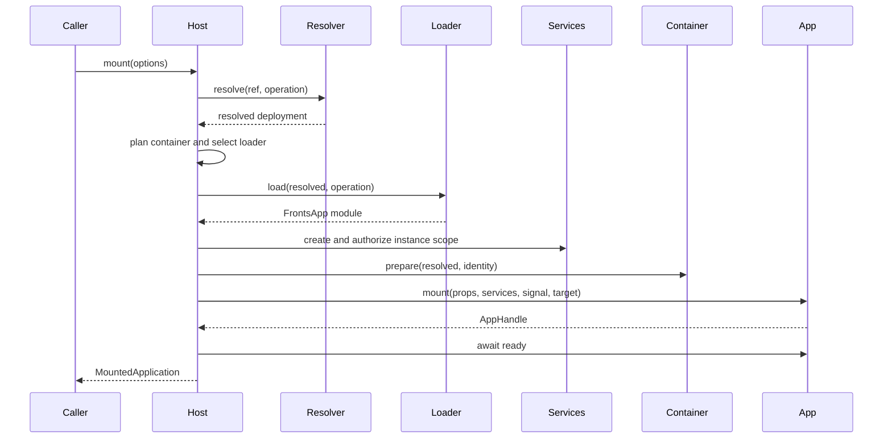

# Host Runtime API

## Purpose

The Host is the single transaction boundary for resolving, loading, authorizing, mounting, replacing,
and cleaning up applications. This guide explains when to use each public operation and the
invariants callers must preserve. TypeScript declarations in
[`host/types.ts`](../packages/core/src/host/types.ts) remain the source of truth for signatures.

Use the same Host path for a platform shell, local producer development, Storybook, or integration
tests. A standalone application needs a static resolver and a local loader; it does not need a
separate lifecycle API or global registration mechanism. See the [core-only example](../examples/core-only/README.md).

## Composition boundary

```ts
import {
  createDomContainer,
  createFrontsHost,
  createShadowContainer,
  createStaticResolver,
} from '@fronts/core';

const host = createFrontsHost({
  hostId: 'store-shell',
  resolver: createStaticResolver([
    {
      match: { name: 'checkout', channel: 'stable' },
      resolve: { source: checkoutSource, version: '2.4.1' },
    },
  ]),
  loader: checkoutLoader,
  containers: [createDomContainer(), createShadowContainer()],
  services: { telemetry },
});
```

The composition root owns the Host, resolver, transport loader, container adapters, static services,
and transport-specific runtime objects. Applications receive only a prepared mount target and their
authorized service facade.

Required boundaries:

- The resolver chooses a deployment; it MUST NOT load or mount application code.
- The loader returns a module containing a valid `FrontsApp`; it MUST NOT own application lifecycle.
- A container owns its execution surface and MUST remove resources it reports as owned.
- The Host owns transaction ordering, cancellation, readiness, rollback, and audit.
- A shell MUST dispose transport objects it created in addition to disposing the Fronts Host.

### Host configuration map

| Option group                                                       | Responsibility                                                                                        |
| ------------------------------------------------------------------ | ----------------------------------------------------------------------------------------------------- |
| `resolver`, `loader`                                               | Required deployment-policy and transport boundaries.                                                  |
| `containers`                                                       | Registry or adapters for DOM, Shadow DOM, iframe, or custom execution surfaces.                       |
| `containerLoaders`                                                 | Optional loader overrides selected by a planned container type.                                       |
| `services`, `createServices`, `capabilityPolicy`                   | Static implementations, instance-bound resources, and application authorization.                      |
| `readyTimeoutMs`                                                   | Host-level readiness deadline; a mount may override it for one application.                           |
| `hostId`, `createInstanceId`, `createOperationId`, `createTraceId` | Stable platform correlation and externally controlled identifiers.                                    |
| `observer`                                                         | Initial non-blocking lifecycle listener; additional listeners use `subscribe()`.                      |
| `now`                                                              | Injectable observability clock for deterministic tests; it is not an authorization or business clock. |

Identifier factories MUST return non-empty strings. Readiness timeouts MUST be finite and
non-negative; `0` disables that deadline but not cancellation. Production Hosts SHOULD set a
deadline from an application SLO instead of disabling it.

## Operation map

| API            | Use when                                                                  | Creates an application instance | Resource/lifecycle effect                         |
| -------------- | ------------------------------------------------------------------------- | ------------------------------- | ------------------------------------------------- |
| `resolve()`    | Inspect the deployment selected for an app reference and policy context.  | No                              | Resolver only                                     |
| `load()`       | Resolve, load, and validate a `FrontsApp` without mounting it.            | No                              | Loader may populate transport caches              |
| `preload()`    | Warm the selected deployment before a likely mount.                       | No                              | Uses loader preload or falls back to load         |
| `mount()`      | Run the complete application transaction and wait for readiness.          | Yes                             | Acquires services, container, and app handle      |
| `replace()`    | Stage a ready replacement while keeping the current instance available.   | Yes                             | Commits the new instance, then cleans the old one |
| `get()`        | Retrieve a currently mounted instance by ID.                              | No                              | None                                              |
| `inspect()`    | Read live or cleanup-retained application transaction snapshots.          | No                              | Prunes clean terminal records                     |
| `audit()`      | Check active instances, pending work, cleanup failures, and retained DOM. | No                              | Synchronous report                                |
| `assertIdle()` | Turn a non-idle audit into a stable runtime-leak error.                   | No                              | None                                              |
| `subscribe()`  | Observe state and error events without joining the transaction.           | No                              | Returns an unsubscribe function                   |
| `unmount()`    | Unmount a live instance by ID.                                            | No                              | Delegates to that instance's cleanup              |
| `dispose()`    | Stop the Host, abort work, unmount everything, and prove cleanup.         | No                              | Terminal and idempotent                           |

Direct `resolve`, `load`, and `preload` operations still count as pending Host work. `dispose()`
aborts them, and `audit().pendingOperations` includes them even though they have no application
identity.

## Resolution, loading, and preloading

### `resolve()`

Use `resolve()` when a caller needs the selected deployment metadata without fetching application
code—for example, to display a rollout decision or inspect an immutable artifact URL.

```ts
const resolved = await host.resolve(
  { name: 'checkout', channel: 'canary', range: '^2' },
  {
    environment: 'production',
    tenant: tenantId,
    cohort: experimentCohort,
    traceId: navigationTraceId,
    signal: navigationSignal,
  },
);
```

Policy fields are untrusted selection inputs. The registry or resolver remains responsible for
authorization; a browser query parameter MUST NOT be treated as proof of tenant or cohort
membership.

### `load()`

`load()` resolves the same reference, invokes the selected loader, and validates the exported
application protocol. It returns `{ app, resolved }` but does not create a container, service scope,
or mounted identity. Use it for producer contract checks or tooling that genuinely needs the loaded
application object. Normal product navigation should call `mount()` directly.

### `preload()`

`preload()` is an optimization, never readiness evidence. If the loader implements `preload`, the
Host delegates to it; otherwise the Host performs a normal load. The later mount MUST resolve policy
again, because a channel, tenant assignment, or registry decision may have changed.

Correlate the two operations with a trace rather than reusing one operation ID:

```ts
await host.preload(ref, { traceId: navigationTraceId, signal: navigationSignal });

const application = await host.mount({
  ref,
  target,
  props,
  traceId: navigationTraceId,
  signal: navigationSignal,
});
```

## The mount transaction

`mount()` resolves only after the application's optional readiness promise has settled successfully.
The returned `MountedApplication.ready` is therefore already settled and is retained as a uniform
consumer surface.



This sequence shows the acquisition order. If any phase fails or is aborted, the Host rolls back
acquired resources in lifecycle order and retains audit evidence when cleanup cannot be proven.

Important rules:

- `instanceId`, `operationId`, and `traceId` are validated and snapshotted before asynchronous work.
- Identity is Host-issued. An app, loader, or browser input MUST NOT supply identity for authorization.
- Props and the target retain caller ownership; Host-owned envelopes such as references, policy,
  resolution metadata, and container requests are snapshotted.
- A container resolver runs after deployment resolution and before loader selection.
- `containerLoaders` may select a transport-specific loader by the planned container type, as the
  iframe integration does.
- Declared capabilities are provisioned and authorized before the application receives services.
- Cancellation can arrive in any phase and always enters the same rollback path.
- Readiness timeout is a failure, not a successful hidden mount.

### Resolution-aware container planning

Pass a resolver instead of a static request when deployment metadata determines the execution
boundary:

```ts
const application = await host.mount({
  ref: { name: 'account' },
  target,
  props,
  container: ({ resolved }) =>
    resolved.metadata?.isolate === true
      ? { type: 'shadow', mode: 'closed' }
      : { type: 'dom', className: 'account-surface' },
});
```

The resolver receives the trusted identity, operation context, frozen resolution policy, resolved
deployment, signal, and Host target. It SHOULD make a deterministic request from those inputs and
MUST NOT mount code itself.

### Contextual services

Use static `services` for stateless shared implementations. Use `createServices` when a capability
must bind an instance identity, tenant, trace, or disposable resource:

```ts
const host = createFrontsHost<Source, HostServices>({
  // resolver, loader, containers...
  services: { navigation },
  async createServices({ identity, operation, resolved, signal }) {
    const span = telemetry.startSpan('fronts.application', {
      instanceId: identity.instanceId,
      traceId: operation.traceId,
      version: resolved.version,
    });

    signal.addEventListener('abort', () => span.addEvent('aborted'), { once: true });

    return {
      services: {
        telemetry: {
          emit(name, data) {
            span.addEvent(name, data);
          },
        },
      },
      dispose() {
        span.end();
      },
    };
  },
  capabilityPolicy: ({ capability, identity }) =>
    capability !== 'navigation' || navigationAllowlist.has(identity.name),
});
```

Provider services override same-named static services for that instance. The application sees only
its declared and authorized own keys through revocable facades. Abort or unmount revokes access
before provider disposal. Providers MUST honor `signal` and roll back partial allocation when they
throw before returning.

## Mounted application controls

```ts
const application = await host.mount({ ref, target, props });

await application.activate();
await application.update(nextProps);
await application.deactivate();
await application.unmount();
```

Instance lifecycle calls are serialized. `activate()` and `deactivate()` are valid even when the
producer omits those optional callbacks; `update()` fails with a lifecycle error when the producer
does not implement updates. `abort(reason)` aborts the instance signal and unmounts it.

Call `application.unmount()` when holding the handle. Use `host.unmount(instanceId)` when an owner
tracks IDs centrally. Successful unmount performs application cleanup, revokes and disposes the
service scope, disposes the container, and removes the live instance from `get()`.

## Readiness-gated replacement

`replace(currentInstanceId, options)` stages the new application in a hidden, inert deployment slot.
The current instance remains available until the replacement resolves, loads, mounts, and becomes
ready.

```ts
const result = await host.replace(current.identity.instanceId, {
  ref: { name: 'checkout', channel: 'stable' },
  target,
  props: nextProps,
  traceId: rolloutTraceId,
});

if (result.previousCleanupError !== undefined) {
  reportCleanupFailure(result.previous, result.previousCleanupError);
}

current = result.application;
```

Replacement invariants:

- A staging failure MUST leave the current instance mounted.
- Commit occurs only after readiness and only when the prepared container remains inside its staging
  slot.
- After commit, failure to clean up the previous instance does not roll back the ready replacement;
  it is returned as `previousCleanupError` and remains visible in audit data.
- Only one replacement may target a given current instance at a time.
- Business validation after readiness is product policy; reverse the registry decision and replace
  again rather than mutating a loaded MF deployment in place.

## Observability and inspection

Use `subscribe()` for non-blocking lifecycle telemetry. A listener MUST NOT throw or perform slow
work inside the Host call stack.

`inspect()` returns application transaction snapshots. `audit()` is the stronger resource view: it
includes live instances, cleanup failures, pending direct operations, replacement transactions, and
owned containers retained after a terminal state.

```ts
const report = host.audit();
if (!report.idle) {
  logger.error('Fronts Host is not idle', report);
}

await host.dispose();
host.assertIdle();
```

Do not use instance or trace IDs as high-cardinality metric labels. Keep them in traces and logs;
aggregate metrics by application, resolved version, container type, phase, and error code.

## Cancellation and errors

Every asynchronous extension receives an `AbortSignal`. Custom resolvers, loaders, container
adapters, service providers, and applications MUST stop acquiring work when it aborts and MUST clean
up anything already acquired.

Catch `FrontsError` by `code` and `phase`; do not parse messages. The stable error vocabulary is
defined in [`errors.ts`](../packages/core/src/errors.ts). Preserve `cause` for diagnostics and redact
tenant-sensitive resolution metadata and service arguments from telemetry.

## Shutdown

The composition root SHOULD call `dispose()` during shell shutdown and after each integration test.
The first call makes the Host terminal; later calls return the same disposal promise. Disposal:

1. rejects new Host work;
2. aborts application and direct-operation signals;
3. waits for pending mounts and replacements;
4. unmounts every live instance;
5. clears listeners;
6. rejects if audit still proves a leak or cleanup failure.

After Host disposal, separately dispose any MF instance plugin resources, registry clients, or other
transport objects owned by the composition root.

## Verification

- `pnpm exec vitest run packages/core/test/host.test.ts packages/core/test/replacement.test.ts`
  verifies operation behavior, lifecycle ordering, cancellation, replacement, and cleanup.
- `pnpm exec vitest run packages/core/test/observability.test.ts packages/core/test/services.test.ts`
  verifies events, audit, contextual service scopes, revocation, and provider disposal.
- [`packages/core/src/host/types.ts`](../packages/core/src/host/types.ts) is the signature source of
  truth for the Host and mounted-instance APIs.
- [`e2e/core-only.spec.ts`](../e2e/core-only.spec.ts) verifies the full Host lifecycle without MF.
- [`e2e/vertical-slice.spec.ts`](../e2e/vertical-slice.spec.ts) verifies the same Host contract across
  React, Vue, DOM, Shadow DOM, and iframe execution.

## Related documentation

- [Application contract](application-contract.md)
- [Architecture](architecture.md)
- [Resolution and delivery](resolution-and-delivery.md)
- [Isolation and security](isolation-and-security.md)
- [Operations](operations.md)
