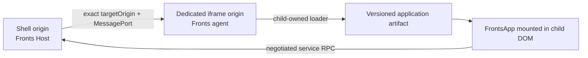
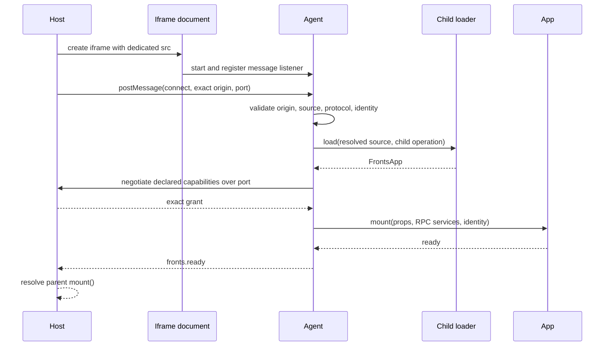

# Iframe deployment

## Purpose

The iframe integration runs a Fronts application in a different browser realm and origin while
preserving the same Host lifecycle. It is appropriate when an application needs stronger DOM and
global isolation, has incompatible dependencies, or must receive only an explicit RPC capability
surface.

It is not a way to evaluate a remote in the parent realm and then move rendered DOM into an iframe.
The child document owns a separate application loader—and, when MF is used, a separate official MF
runtime instance. Public types in [`@fronts/core/iframe`](../packages/core/src/iframe/index.ts) are the
signature source of truth.

## Deployment topology



This shows the security boundary. The shell never evaluates the isolated application. The agent
origin may load the application from a third artifact origin, provided that the artifact server and
the child document's browser policy allow it.

A production deployment normally has:

1. a shell origin, for example `https://app.example.com`;
2. a dedicated agent origin, for example `https://fronts-frame.example.net`;
3. one or more immutable application artifact origins or paths.

The agent origin MUST differ from the shell origin. It SHOULD contain only the minimal agent shell,
loader, and policies required to run isolated applications.

## Parent Host wiring

Three pieces must be registered together:

- `createIframeContainer()` creates and owns the `<iframe>` element;
- `createIframeProxyLoader()` presents remote iframe lifecycle as a `FrontsApp` in the parent;
- `containerLoaders.iframe` selects that proxy instead of evaluating the resolved source in the
  parent realm.

<!-- typecheck: federation -->

```ts
import { createDomContainer, createFrontsHost, createStaticResolver } from '@fronts/core';
import { createIframeContainer, createIframeProxyLoader } from '@fronts/core/iframe';
import {
  createModuleFederationAdapter,
  createModuleFederationSource,
  type ModuleFederationSource,
} from '@fronts/mf';

interface HostServices {
  navigation: { go(path: string): void };
  telemetry: { emit(name: string, data?: unknown): void };
}

const parentLoader = createModuleFederationAdapter({ instance: parentFederation });

const host = createFrontsHost<ModuleFederationSource, HostServices>({
  resolver: createStaticResolver([
    {
      match: { name: 'isolated-checkout' },
      resolve: {
        source: createModuleFederationSource({
          name: 'checkout_2_4_1',
          entry: 'https://cdn.example.com/checkout/2.4.1/mf-manifest.json',
        }),
        version: '2.4.1',
        metadata: {
          frame: {
            src: 'https://fronts-frame.example.net/agent',
            targetOrigin: 'https://fronts-frame.example.net',
          },
        },
      },
    },
  ]),
  loader: parentLoader,
  containerLoaders: {
    iframe: createIframeProxyLoader<ModuleFederationSource, HostServices>({
      capabilities: ['navigation', 'telemetry'],
      handshakeTimeoutMs: 10_000,
      requestTimeoutMs: 10_000,
    }),
  },
  containers: [createDomContainer(), createIframeContainer()],
  services,
  capabilityPolicy: ({ capability, identity }) =>
    capability !== 'navigation' || navigationAllowlist.has(identity.name),
});
```

The normal `loader` remains available for non-iframe containers. The `iframe` loader override is
what prevents the parent from loading the isolated source.

### Resolution-aware frame request

Generate the iframe request after deployment resolution so a registry can select an origin by
environment, tenant, release channel, or cohort:

```ts
function readFrame(value: unknown): { src: string; targetOrigin: string } {
  if (typeof value !== 'object' || value === null) throw new Error('Missing frame metadata.');
  const src = Reflect.get(value, 'src');
  const targetOrigin = Reflect.get(value, 'targetOrigin');
  if (typeof src !== 'string' || typeof targetOrigin !== 'string') {
    throw new Error('Invalid frame metadata.');
  }
  return { src, targetOrigin };
}

const application = await host.mount({
  ref: { name: 'isolated-checkout', channel: 'stable' },
  target: document.querySelector('#application-slot')!,
  props: { cartId: 'C-42' },
  container: ({ identity, resolved }) => {
    const frame = readFrame(resolved.metadata?.frame);
    return {
      type: 'iframe',
      src: frame.src,
      targetOrigin: frame.targetOrigin,
      title: `${identity.name} application`,
      sandbox: ['allow-same-origin', 'allow-scripts'],
      referrerPolicy: 'strict-origin-when-cross-origin',
    };
  },
});
```

Registry metadata MUST be validated before it becomes a container request. `targetOrigin` is a
canonical origin only—scheme, host, and optional port, with no path—and `src` must resolve to that
same origin. Wildcard target origins are rejected.

## Child agent wiring

The child document creates its own loader and starts one iframe agent:

<!-- typecheck: federation -->

```ts
import { createInstance } from '@module-federation/runtime';
import { createIframeAgent } from '@fronts/core/iframe';
import { createModuleFederationAdapter, type ModuleFederationSource } from '@fronts/mf';

const target = document.createElement('main');
document.body.append(target);

const childFederation = createInstance({ name: 'checkout_iframe_agent', remotes: [] });
const childLoader = createModuleFederationAdapter({ instance: childFederation });

const agent = createIframeAgent<ModuleFederationSource>({
  allowedOrigins: ['https://app.example.com'],
  hostId: 'checkout-iframe-agent',
  loader: childLoader,
  requestTimeoutMs: 10_000,
  target,
});

window.addEventListener(
  'beforeunload',
  () => {
    void agent.stop().catch(reportAgentShutdownFailure);
  },
  { once: true },
);
```

`allowedOrigins` MUST contain one or more exact canonical parent origins and MUST NOT contain `*`.
The agent also checks that the message source is its expected parent window, validates the protocol
shape and version, and accepts exactly one transferred `MessagePort` per connection.

The child loader receives the parent-resolved deployment and trusted identity in an
application-scoped operation context. It loads and validates the real `FrontsApp`, mounts it into an
agent-owned root, waits for application readiness, and then notifies the parent.

## Handshake and readiness



This sequence is one Host mount transaction. Parent readiness does not complete until the child
application has loaded, negotiated capabilities, mounted, and reported ready. A fatal child error,
timeout, or cancellation rejects the parent mount and triggers cleanup on both sides.

The connection envelope carries resolved source data, metadata, identity, and props through the
structured clone algorithm. Those values MUST be structured-cloneable; functions, DOM nodes,
proxies, and other realm-bound objects cannot be used as iframe source metadata or props.

## Capability negotiation

The final service grant is the intersection of:

1. the maximum configured on `createIframeProxyLoader` for that resolved deployment;
2. capabilities actually available from the parent instance service scope after provisioning and
   `capabilityPolicy`;
3. capabilities declared by the real application loaded in the child.

The proxy maximum is not treated as the child's declaration. The child must request its complete
declared set exactly once; missing or additional capabilities fail closed. The parent validates the
locked grant again on every `service.call`.

Services are method-only RPC facades. The child never receives the original parent object. RPC
arguments and results MUST be structured-cloneable, and privileged services MUST validate every
argument in the parent implementation. Bind tenant, identity, authorization, and audit data in the
parent's `createServices` closure rather than accepting those claims from child arguments.

Do not expose ambient authority such as:

- raw access tokens or cookie values;
- unrestricted `fetch`, storage, DOM, or browser globals;
- generic `eval`, script execution, or arbitrary method dispatch;
- navigation without destination validation;
- telemetry that accepts unbounded or sensitive payloads.

Rate-limit expensive calls and record denied capability requests and privileged invocations with
the parent-issued identity.

## Origin and sandbox contract

The built-in transport intentionally requires both `allow-scripts` and `allow-same-origin`:

- scripts are required to run the child agent;
- preserving the dedicated child origin is required for an exact `targetOrigin` handshake;
- the container rejects an agent `src` whose origin equals the parent document origin.

On a dedicated cross-origin deployment, `allow-same-origin` preserves the child's own origin; it
does not make it same-origin with the shell. Never serve this agent from the shell origin: combining
same-origin content, scripts, and `allow-same-origin` weakens the intended sandbox boundary.

The default sandbox is the required pair. Add tokens and browser permissions only after reviewing
the application need. Generic `attributes` cannot override `src`, `srcdoc`, `sandbox`, `allow`,
loading/name/referrer/title fields, Fronts `data-*` state, or inline event handlers.

`targetOrigin="*"` is never allowed. The child checks both `event.origin` and `event.source`, and all
subsequent traffic moves onto the transferred, random-channel-bound `MessagePort`.
Creating that channel requires `globalThis.crypto.randomUUID()`; production shells MUST run in a
browser context where it is available, normally a secure HTTPS context.

## Browser and server policy

Fronts validates the runtime handshake, not the surrounding HTTP deployment. Configure at least:

- shell CSP `frame-src` for the exact agent origin;
- child CSP `script-src` and `connect-src` for its loader, manifest, remote entry, chunks, APIs, and
  telemetry endpoints;
- CORS headers on module/manifest/chunk origins needed by the child loader;
- `frame-ancestors` on the agent response so only approved shells may embed it;
- HTTPS and immutable artifact URLs in production;
- cookie `SameSite`, `Secure`, and domain scope appropriate to a cross-site frame;
- restrictive permissions through the iframe `allow` property;
- compatible COOP/COEP/CORP headers when cross-origin isolation is enabled.

Never put credentials or bearer tokens in `src`, manifest URLs, query strings, or resolution
metadata. Server-side APIs remain responsible for authentication and authorization.

## Timeouts and cancellation

There are three independent deadlines:

| Deadline              | Owner                          | Covers                                                    |
| --------------------- | ------------------------------ | --------------------------------------------------------- |
| Host `readyTimeoutMs` | `createFrontsHost` / `mount()` | The complete application mount and readiness transaction. |
| `handshakeTimeoutMs`  | Parent iframe proxy            | Frame load and child-agent readiness handshake.           |
| `requestTimeoutMs`    | Parent proxy and child agent   | Individual lifecycle and service RPC calls.               |

Values must be finite and non-negative. `0` disables the corresponding deadline while abort
signals remain active. Production deployments SHOULD keep all three finite and choose the Host
readiness budget to accommodate child loading and application readiness.

Navigation cancellation, Host disposal, child session stop, and RPC cancellation all propagate
through `AbortSignal`. Custom child loaders and application code MUST stop work and release partial
resources when aborted.

## Lifecycle and shutdown

Parent `update`, `activate`, and `deactivate` calls become correlated RPC requests to the child
handle. Unmount proceeds as follows:

1. the parent requests child lifecycle unmount;
2. the child aborts its session and cleans the real app handle;
3. the child removes its agent root and closes the RPC peer;
4. the parent closes its peer and the Host revokes the instance service scope;
5. the iframe container removes the owned element.

The parent composition root MUST call `host.dispose()`. The child shell MUST call `agent.stop()` when
it owns a longer-lived agent lifecycle. `agent.stop()` is idempotent, stops every active session, and
reports an aggregate lifecycle failure if any child application cannot clean up.

The exported `IframeRpcPeer` is a low-level protocol primitive used by the built-in proxy and agent.
Application teams SHOULD use the Host service facade instead of registering custom RPC methods or
manually constructing connect messages.

## Production checklist

- [ ] The agent uses a dedicated origin different from every embedding shell origin.
- [ ] The shell runs in a context that provides `crypto.randomUUID()` for channel identifiers.
- [ ] `src`, `targetOrigin`, and child `allowedOrigins` are exact and environment-specific.
- [ ] The frame keeps `allow-scripts` and `allow-same-origin`; every additional token is reviewed.
- [ ] Host `frame-src`, child `frame-ancestors`, `script-src`, and `connect-src` are explicit.
- [ ] Remote manifests, entries, chunks, and APIs are HTTPS and CORS-compatible from the child.
- [ ] Resolved source, metadata, props, service arguments, and results are structured-cloneable.
- [ ] The proxy maximum, Host policy, and producer declaration yield the intended capability grant.
- [ ] Privileged service methods validate inputs, bind trusted identity, rate-limit, and audit calls.
- [ ] Handshake, request, and Host readiness timeouts reflect production SLOs.
- [ ] Parent shutdown calls `host.dispose()` and child shutdown calls `agent.stop()`.
- [ ] Browser E2E proves mount, readiness, service calls, update, navigation, and cleanup from distinct
      origins.

## Non-goals

The iframe integration does not provide SES/Realm confinement, network interception, storage
partitioning, dependency integrity verification, or a complete browser sandbox. Code that cannot be
trusted with the configured child origin and browser permissions belongs in a more restrictive
execution system or separate application boundary.

## Verification

- `pnpm exec vitest run packages/core/test/iframe.test.ts` verifies origin rejection, sandbox
  requirements, protocol validation, RPC cancellation/timeouts, capability negotiation, lifecycle,
  rollback, and agent shutdown.
- `pnpm exec playwright test e2e/vertical-slice.spec.ts` verifies a real cross-origin iframe agent,
  independent child MF runtime, readiness, updates, navigation service RPC, and browser cleanup.
- [`examples/react-host/src/runtime.ts`](../examples/react-host/src/runtime.ts) is the parent wiring
  reference.
- [`examples/iframe-remote/src/index.ts`](../examples/iframe-remote/src/index.ts) is the child agent
  wiring reference.
- Human review is required for production origins, CSP, iframe permissions, cookie policy, exposed
  capabilities, and service-side authorization; repository tests cannot prove deployment headers.

## Related documentation

- [Isolation and security](isolation-and-security.md)
- [Host Runtime API](host-runtime-api.md)
- [Application contract](application-contract.md)
- [Operations](operations.md)

# Citations

- [WHATWG cross-document and channel messaging](https://html.spec.whatwg.org/multipage/web-messaging.html)
- [WHATWG iframe sandbox](https://html.spec.whatwg.org/multipage/iframe-embed-object.html#attr-iframe-sandbox)
- [Content Security Policy `frame-src`](https://developer.mozilla.org/en-US/docs/Web/HTTP/Reference/Headers/Content-Security-Policy/frame-src)
- [Official Module Federation Runtime API](https://module-federation.io/guide/runtime/runtime-api)
