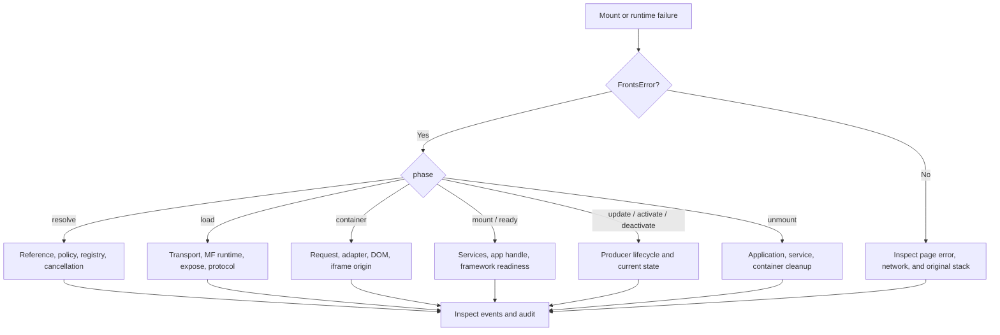

# Troubleshooting Fronts Runtime failures

## Start here

Diagnose from the Fronts transaction boundary before changing bundler or application code. A
`FrontsError` supplies three independent clues:

- `code` identifies the stable failure category;
- `phase` identifies the owner boundary active when it failed;
- `cause` preserves the resolver, loader, framework, container, service, or browser error.

Do not parse the human-readable message and do not discard `cause`. The current code vocabulary is
defined in [`errors.ts`](../packages/core/src/errors.ts).

<!-- typecheck: diagnostics -->

```ts
import { isFrontsError } from '@fronts/core';

try {
  await host.mount(options);
} catch (error) {
  if (isFrontsError(error)) {
    logger.error('Fronts transaction failed', {
      code: error.code,
      phase: error.phase,
      details: error.details,
      cause: error.cause,
    });
  }
  logger.error('Fronts audit after failure', host.audit());
}
```

Redact source URLs containing credentials, tenant metadata, props, and service arguments before
shipping diagnostic data.

## Triage flow



This flow prevents transport errors from being treated as lifecycle bugs and prevents cleanup
failures from being hidden by the primary mount error.

## Phase guide

| Phase                            | First owner to inspect               | Primary evidence                                      |
| -------------------------------- | ------------------------------------ | ----------------------------------------------------- |
| `resolve`                        | App reference, policy, registry      | Resolver response, operation context, registry trace  |
| `load`                           | Custom loader or official MF runtime | Network requests, MF hooks/trace, loaded module shape |
| `container`                      | Planned request and adapter          | Resolved metadata, adapter output, DOM/iframe state   |
| `mount`                          | Service provisioning and producer    | Capability decision, provider error, app mount stack  |
| `ready`                          | Producer/framework readiness         | Readiness promise, render error, timeout/cancellation |
| `update`/`activate`/`deactivate` | Mounted producer handle              | Instance state, original lifecycle error              |
| `unmount`                        | Producer, service scope, container   | Aggregate cause, cleanup audit, retained element      |

One replacement spans several phases. Diagnose its staging failure by the reported phase; diagnose
`previousCleanupError` as a committed replacement with an old-instance unmount failure.

## Error categories

| Code family                                              | Meaning and first check                                                                                                   |
| -------------------------------------------------------- | ------------------------------------------------------------------------------------------------------------------------- |
| `FRONTS_RESOLUTION_FAILED`                               | Resolver rejected, returned an invalid/mismatched deployment, or was cancelled. Inspect normalized ref and policy.        |
| `FRONTS_LOAD_FAILED`                                     | Loader/MF registration or loading failed. Inspect the nested runtime/network cause before changing Fronts lifecycle code. |
| `FRONTS_INVALID_APP`, `FRONTS_UNSUPPORTED_PROTOCOL`      | The loaded expose is not a compatible branded Fronts application. Inspect the producer export.                            |
| `FRONTS_CONTAINER_FAILED`                                | Request planning, adapter lookup/preparation, or rollback failed. Inspect container type and prepared result.             |
| `FRONTS_IFRAME_PROTOCOL`                                 | Origin, sandbox, connect envelope, identity, capability, or RPC frame validation failed.                                  |
| `FRONTS_CAPABILITY_DENIED`                               | A declared service is unavailable, rejected by policy, or outside an iframe grant.                                        |
| `FRONTS_MOUNT_FAILED`, `FRONTS_READY_TIMEOUT`            | Producer mount/readiness failed or exceeded its deadline. Inspect framework errors and readiness settlement.              |
| `FRONTS_LIFECYCLE_FAILED`, `FRONTS_INVALID_STATE`        | A mounted handle failed or the operation is invalid in its current state.                                                 |
| `FRONTS_DUPLICATE_INSTANCE`, `FRONTS_INSTANCE_NOT_FOUND` | Caller instance ownership is inconsistent. Inspect ID creation and stale handles.                                         |
| `FRONTS_ABORTED`, `FRONTS_HOST_DISPOSED`                 | Navigation/owner cancellation or use after terminal Host disposal. Inspect the signal owner and shutdown order.           |
| `FRONTS_RPC_TIMEOUT`, `FRONTS_RPC_CLOSED`                | Iframe agent or service lifecycle request did not complete on an open channel.                                            |
| `FRONTS_RUNTIME_LEAK`                                    | Audit proves active work, cleanup failure, replacement, or retained owned DOM after expected shutdown.                    |

Use `frontsErrorCodes` from the package rather than duplicating string literals in application
control flow.

## Resolution failures

Check in this order:

1. Validate `AppRef.name`, `expose`, `range`, and `channel`; fields must be own, correctly typed
   values and identifiers must be non-empty.
2. Confirm environment, tenant, cohort, and metadata came from a trusted shell policy source.
3. Confirm the resolver returned the same normalized `ref`, a valid source, and optional non-empty
   version.
4. Inspect whether caller cancellation or Host disposal aborted the registry request.
5. For cached/fallback resolvers, record whether the result came from primary, cache, or fallback
   policy; do not silently turn an authorization failure into a stale cache hit.

Reproduce resolution without loading code:

```ts
const resolved = await host.resolve(ref, {
  environment,
  tenant,
  cohort,
  traceId,
  signal,
});
```

If this fails, MF, containers, service providers, and producer code are not yet involved.

## Module Federation and loader failures

### Manifest or entry cannot be fetched

- Open the exact manifest or remote entry URL from the same browser context.
- Check HTTP status, redirects, CORS, MIME type, TLS, CSP, and final public asset base.
- For a manifest, confirm the response is an MF manifest rather than an HTML fallback, gateway error,
  or unrelated JSON payload.
- Confirm every referenced entry/chunk URL is reachable from the Host—or from the iframe agent when
  isolation is selected.
- Compare development and production-preview output; a dev server success does not prove built asset
  paths.

### Remote loads with the wrong format

- An ESM raw entry must be registered with the compatible runtime entry type, such as
  `type: 'module'`.
- A global-format entry needs the producer's expected global/container name.
- Prefer an MF manifest when the producer emits one; it preserves official runtime metadata and
  avoids manually duplicating entry details.
- OriginJS in this repository is only a production ESM fixture. Its `dev` command builds and previews
  the remote; it is not a bundleless remote dev claim.

### Remote or expose is not found

- Compare `ModuleFederationSource.remote.name`/`alias` with the runtime registration.
- Compare `AppRef.expose` with the producer's exposed key, including case and `./` normalization.
- Confirm the low-level adapter received the intended official MF runtime instance, or inspect
  `composition.runtime` when the Host was built with `createMfHost()`.
- Inspect official runtime hooks or DevTools to separate registration, manifest, entry, expose, and
  shared-dependency failures.

### Remote name is already bound

`@fronts/mf` rejects silently reusing one remote name for another source or resolved version on the
same runtime instance. Use immutable deployment-specific names. Do not enable `force` merely to make
the error disappear: official force replacement clears loaded-module caches and changes the shared
runtime state.

Use force only as an explicit deployment operation with rollback and concurrency review.

### Shared dependency fails

Fronts does not select MF shared versions. Inspect producer/Host share scopes, package names,
versions, singleton/eager settings, and whether a fallback was emitted. A plugin-free runtime Host
does not automatically provide the build-time share graph of a Vite producer.

The OriginJS fixture intentionally keeps its generated `@fronts/core` fallback. The official and
unscoped Vite fixtures bundle the small Fronts protocol instead of relying on a Host share.

## Invalid application exports

The requested expose must default-export an object created by `defineApp()`, `defineReactApp()`, or
`defineVueApp()`:

```ts
export default defineApp({
  mount() {
    return { unmount() {} };
  },
});
```

Common failures:

- exporting a React/Vue component instead of a Fronts application;
- exposing a named export while the remote module default is unrelated;
- returning no handle or a handle without `unmount()`;
- hand-constructing an object that lacks the current protocol brand/version;
- wrapping the module so the application is under `default.default`.

Use `host.load()` to isolate resolver/loader/protocol validation from container and mount behavior.

## Container failures

For DOM, Shadow DOM, and custom containers:

- confirm the planned request has a registered, non-empty own `type`;
- validate registry metadata before returning a dynamic container request;
- confirm the Host target belongs to a live document and accepts the new element;
- custom adapters must return matching `type`, an element, a valid mount target, and `dispose()`;
- if `ownsElement` is true, disposal must detach it even after partial failure;
- never mutate a request or resolved envelope after passing it to the Host.

If a custom adapter returns an invalid prepared object, Fronts attempts rollback. Inspect the error
cause for both validation and cleanup failures.

## Capability and service failures

For `FRONTS_CAPABILITY_DENIED`:

1. inspect the producer's declared capability names;
2. verify the service exists as an own key in static or provider services;
3. inspect `capabilityPolicy` with the Host-issued identity;
4. inspect whether `createServices` returned a valid service object before cancellation;
5. for iframe, compare proxy maximum, parent-authorized scope, and child declaration.

Provider services override same-named static services for one instance. If a provider allocates a
span, subscription, channel, or tenant client, its disposer must tolerate partial mount rollback and
run exactly once.

Do not “fix” a denial by exposing all services. Add the narrow capability, policy decision, argument
validation, and audit attribution the application actually needs.

## Mount and readiness failures

Differentiate mount from readiness:

- `mount` failure means service setup, producer `mount()`, handle validation, or immediate framework
  setup failed;
- `ready` failure means the returned handle did not become ready, rejected, timed out, or was
  cancelled after mount.

Check framework error boundaries/handlers and the original render exception. A producer readiness
promise must resolve after the framework commits usable UI, not merely after scheduling a render.
Every mount path must return an `unmount()` implementation even when update/activation are omitted.

A timeout should trigger rollback. Increasing the timeout is appropriate only when measured startup
SLOs justify it; it does not repair a readiness promise that never settles.

## Lifecycle and replacement failures

- `update()` is optional in the producer contract, but calling it when absent intentionally fails.
- Updates and activate/deactivate calls are serialized; inspect the prior operation before assuming
  a race in the Host.
- Do not call lifecycle methods after unmount, abort, failure, or Host disposal.
- Use the current live `instanceId`; successful unmount removes it from `host.get()`.

For replacement:

- the current instance must be `ready`, `active`, or `inactive`;
- only one replacement may target it at a time;
- a staging failure leaves the current instance in place;
- `previousCleanupError` means the new instance committed successfully but the previous instance
  leaked or failed unmount—serve the new instance and investigate cleanup;
- if product validation fails after readiness, move the registry/channel decision back and perform
  another replacement rather than overwriting an already loaded MF registration.

## Iframe failures

### Frame never connects

- `src` and `targetOrigin` must resolve to the same exact, canonical child origin.
- The child origin must differ from the shell origin.
- The sandbox must include `allow-scripts` and `allow-same-origin`.
- The shell must provide `crypto.randomUUID()`.
- Child `allowedOrigins` must contain the exact shell origin; `*` is rejected.
- Confirm the agent bundle ran before the frame `load` event completed and no CSP error blocked it.
- Confirm shell `frame-src`, child `frame-ancestors`, script/connect CSP, and artifact CORS.

### Handshake or RPC times out

- Compare Host readiness, proxy handshake, parent request, and child request deadlines.
- Inspect whether the child loader fetched the resolved artifact and whether the real app reported
  readiness.
- Check both parent and child console errors; child fatal errors are serialized back to the parent.
- Confirm props, source, metadata, service arguments, and results are structured-cloneable.
- Check whether navigation or Host shutdown aborted the operation.

### Service is present in parent but absent in child

The parent only offers services that survive proxy maximum, instance provisioning, and policy. The
real child declaration must then be a subset of that offer and receives exactly its declared set.
Inspect all three inputs; do not manually call the low-level negotiation or `IframeRpcPeer` APIs.

## Non-idle audit and cleanup failures

After route teardown or tests:

```ts
await host.dispose();
host.assertIdle();
```

If this fails, inspect all audit fields:

| Audit field               | Typical owner                                                        |
| ------------------------- | -------------------------------------------------------------------- |
| `activeInstances`         | Missing application/route unmount or unfinished mount.               |
| `pendingOperations`       | Resolver, loader, provider, mount, or late cleanup has not settled.  |
| `replacementTransactions` | A replacement is still staging or cleaning up.                       |
| `cleanupFailures`         | Producer unmount, provider disposer, or container disposer rejected. |
| `retainedContainers`      | An owned terminal container element remains attached.                |

Do not hide a leak by removing DOM manually or discarding the Host. Fix the owning disposer and keep
the audit failure as a CI gate. `inspect()` retains snapshots whose cleanup could not be proven and
Host events preserve successful terminal transitions after records are released.

## Reproducing repository integration paths

```sh
pnpm check
pnpm test:e2e
pnpm test:e2e:preview
```

Use development E2E to reproduce live-server composition. Use production preview to catch emitted
manifest, remote entry, public-path, code-splitting, and shared fallback differences.

Focused commands:

```sh
pnpm exec vitest run packages/core/test/host.test.ts
pnpm exec vitest run packages/core/test/iframe.test.ts
pnpm exec vitest run packages/mf/test
pnpm exec playwright test e2e/vite-runtime.spec.ts
```

## Incident evidence

Capture these together:

- `hostId`, `operationId`, intent, trace ID, instance ID, app name, version, expose, container type;
- Fronts error code, phase, details, and redacted cause chain;
- registry deployment/policy revision and whether cache/fallback was used;
- MF instance name, remote name/alias, manifest/entry URL, entry type, and official runtime trace;
- browser engine, framework, producer plugin, development/preview mode, and network waterfall;
- `host.inspect()` and `host.audit()` after failure and after attempted cleanup.

Never attach auth tokens, cookies, raw tenant metadata, sensitive props, or unredacted service
arguments to a public issue.

## Recovery principles

- Prefer registry/channel rollback to mutating an already loaded artifact.
- Retry network failures only with bounded backoff and cancellation; do not blindly retry script
  execution, protocol, policy, or capability failures.
- Preserve the first failure as authoritative and retain cleanup failures separately.
- Keep the current application available during replacement staging.
- Treat `previousCleanupError` and non-idle audit as incidents even when the new UI is serving.
- Reproduce against production-preview output before declaring a bundler compatibility fix.

## Verification

- [`packages/core/test`](../packages/core/test) covers Fronts error phases, rollback, cancellation,
  lifecycle, capabilities, iframe, replacement, and audit behavior.
- [`packages/mf/test`](../packages/mf/test) covers MF source validation, registration conflicts,
  preload/load mapping, and real-runtime loading.
- [`e2e`](../e2e) proves the supported browser paths and cleanup assertions.
- [Operations](operations.md) defines the event, metric, audit, and incident-correlation model.
- [Module Federation integrations](module-federation-integrations.md) defines the producer claim
  boundaries used by this runbook.

## Related documentation

- [Host Runtime API](host-runtime-api.md)
- [Iframe deployment](iframe-deployment.md)
- [Support policy](support-policy.md)
- [Isolation and security](isolation-and-security.md)

# Citations

- [Official Module Federation runtime troubleshooting](https://module-federation.io/guide/troubleshooting/runtime)
- [Official Module Federation build troubleshooting](https://module-federation.io/guide/troubleshooting/build)
- [Official Module Federation debug variables](https://module-federation.io/guide/debug/variables)
