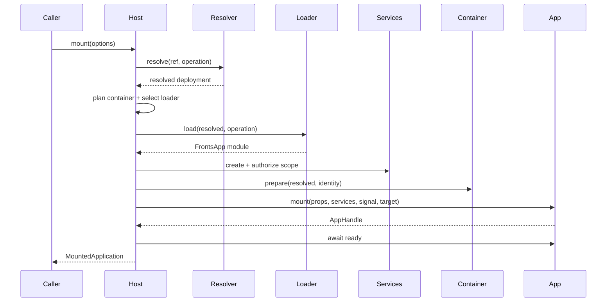

Host 是解析、加载、授权、挂载、替换和清理应用的唯一事务边界。精确签名以
[`packages/core/src/host/types.ts`](https://github.com/unadlib/fronts/blob/main/packages/core/src/host/types.ts)
为准。平台 shell、本地 producer 开发、Storybook 和集成测试应走同一条 Host 路径；独立应用只需
静态 resolver 与本地 loader，不需要全局注册或第二套 lifecycle API。

## 组合边界

```ts
const host = createFrontsHost({
  hostId: 'store-shell',
  resolver: createStaticResolver([
    {
      match: { name: 'checkout', channel: 'stable' },
      resolve: { source: checkoutSource, version: '2.4.1' },
    },
  ]),
  loader: checkoutLoader,
  containers: [createDomContainer(), createShadowContainer()],
  services: { telemetry },
});
```

composition root 拥有 Host、resolver、transport loader、container adapter、静态 services 和
transport runtime。resolver 只选部署，不加载代码；loader 只返回包含有效 `FrontsApp` 的 module，
不拥有应用生命周期；container 拥有执行面和自己声明的资源；Host 拥有事务顺序、取消、readiness、
rollback 与 audit。Shell 还必须单独 dispose 自己创建的 MF instance plugin、registry client 等资源。

主要配置包括必需的 `resolver`/`loader`，容器集合和按 type 覆盖的 `containerLoaders`，静态
`services`、实例 `createServices` 与 `capabilityPolicy`，`readyTimeoutMs`，可控的 host/instance/
operation/trace ID factory，非阻塞 observer 与测试时钟。ID factory 必须返回非空字符串；timeout
必须有限且非负，`0` 只关闭该 deadline，不关闭取消。生产环境应从应用 SLO 设置有限值。

## 操作地图

| API                      | 用途                                               | 是否创建实例 | 主要影响                           |
| ------------------------ | -------------------------------------------------- | ------------ | ---------------------------------- |
| `resolve()`              | 查看策略选出的部署                                 | 否           | 仅 resolver                        |
| `load()`                 | 解析、加载并验证 app，不挂载                       | 否           | 可能填充 transport cache           |
| `preload()`              | 预热可能使用的部署                                 | 否           | loader preload 或 fallback load    |
| `mount()`                | 完整事务并等待 ready                               | 是           | services、container、app handle    |
| `replace()`              | 保持当前实例可用并 staging 候选                    | 是           | 提交新实例后清理旧实例             |
| `get()`/`inspect()`      | 读取 live handle 或事务 snapshot                   | 否           | inspect 会裁剪干净 terminal record |
| `audit()`/`assertIdle()` | 检查实例、pending、cleanup failure 和 retained DOM | 否           | assert 转成稳定 leak error         |
| `subscribe()`            | 非阻塞观测 state/error event                       | 否           | 返回 unsubscribe                   |
| `unmount()`              | 按 ID 卸载 live instance                           | 否           | 执行该实例完整清理                 |
| `dispose()`              | 停止 Host、abort、卸载并证明清理                   | 否           | terminal 且幂等                    |

直接 resolve/load/preload 也计入 pending Host work；它们没有 application identity，但会出现在
`audit().pendingOperations`，并被 `dispose()` abort。

## 解析、加载和预加载

`resolve()` 适合在不取代码时显示 rollout 决策或不可变 artifact URL。environment、tenant、cohort
等字段是不可信的选择输入，不是授权凭证；registry 必须自行认证和授权。`load()` 返回
`{ app, resolved }`，但不创建 target、service scope 或 mounted identity，主要用于 producer
contract 工具，普通导航应直接 mount。

`preload()` 只是优化，绝不是 readiness 证据。loader 没有 preload 时 Host 会普通 load；之后的
mount 必须重新解析，因为 channel、tenant assignment 或 registry decision 可能变化。可用相同
trace 关联 preload 和 mount，但不能重用 operation ID。

## 挂载事务



Host 在异步工作前校验并快照 instance/operation/trace ID。identity 只能由 Host 颁发，应用、loader
或浏览器输入不得提供授权身份。caller 仍拥有 props 与外部 target；reference、policy、resolution
metadata 和 container request 等 Host envelope 会被快照。任一阶段失败或 abort 都走同一条回滚，
readiness timeout 是失败，不能作为隐藏成功。

部署 metadata 决定隔离方式时，可传 container resolver：

```ts
container: ({ resolved }) =>
  resolved.metadata?.isolate === true
    ? { type: 'shadow', mode: 'closed' }
    : { type: 'dom', className: 'account-surface' };
```

它在 resolution 之后、loader 选择之前运行，收到可信 identity、operation、冻结的 policy/resolved、
signal 与 Host target；必须确定性地产生 request，不能自行 mount。

## 上下文服务

无状态共享实现使用静态 `services`；需要绑定实例、租户、trace 或 disposable resource 时使用
`createServices`。provider service 覆盖同名静态 service，之后 Host 才按声明和 policy 生成仅含
own keys 的可撤销 facade。abort/unmount 先 revoke，再 dispose provider；provider 必须响应 signal，
并在返回前抛错时自行回滚尚未移交的资源。

```ts
async createServices({ identity, operation, resolved, signal }) {
  const span = telemetry.startSpan('fronts.application', {
    instanceId: identity.instanceId,
    traceId: operation.traceId,
    version: resolved.version,
  });
  signal.addEventListener('abort', () => span.addEvent('aborted'), { once: true });
  return {
    services: { telemetry: { emit: (name, data) => span.addEvent(name, data) } },
    dispose: () => span.end(),
  };
}
```

## 实例控制与就绪替换

`activate()`、`update(nextProps)`、`deactivate()` 与 `unmount()` 在每个实例上串行。producer 没有
activate/deactivate callback 时它们仍有效；没有 update 时则返回 lifecycle error。`abort(reason)`
触发 instance signal 并卸载。持有 handle 时调用 `application.unmount()`，集中跟踪 ID 时调用
`host.unmount(id)`。

`replace(id, options)` 在 hidden/inert staging slot 中挂载候选；候选 resolve/load/mount/ready
全部成功前，当前实例保持可用。staging 失败必须保留旧实例；commit 后旧实例 cleanup 失败不回滚
已 ready 的新实例，而是返回 `previousCleanupError` 并留在 audit；同一 current instance 只能有一个
replacement。业务验证失败应回退 registry 决策再 replace，不能直接修改活跃 MF deployment cache。

## 观测、错误和关闭

`subscribe()` listener 不参与事务，不得在 Host call stack 中抛错或慢执行。`inspect()` 看事务状态，
`audit()` 还包含 live instance、cleanup failure、direct operation、replacement 和 terminal state 后
仍保留的容器。instance/trace ID 放日志与 trace，不要做高基数 metric label；metric 应按 app、version、
container type、phase、error code 聚合。

捕获 `FrontsError` 时使用稳定的 `code` 和 `phase`，不要解析 message；保留 `cause` 但在 telemetry
中移除 tenant-sensitive metadata 与 service 参数。composition root 在 shell shutdown 和每个集成测试
后调用 `dispose()`：它拒绝新任务、abort signals、等待 pending mount/replace、卸载全部 live app、
清除 listener，并在 audit 仍证明泄漏时 reject。最后用 `host.assertIdle()` 明确验证。

## 验证

core host/replacement/observability/services 测试覆盖顺序、取消、替换、审计与 provider disposal；
core-only E2E 验证无 MF 路径，vertical-slice E2E 验证 React、Vue、DOM、Shadow DOM 和 iframe 的同一契约。
