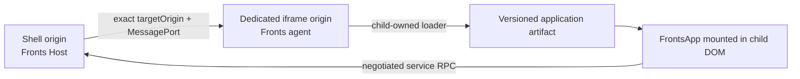
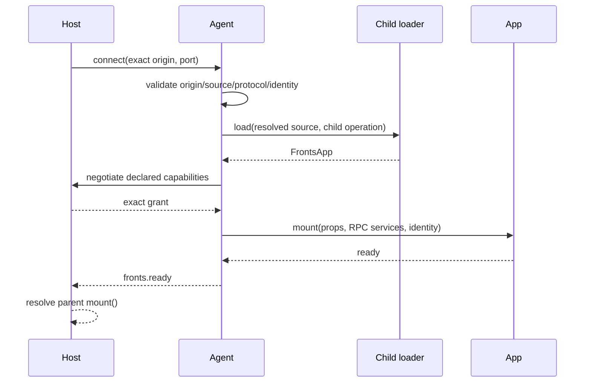

## 目的与拓扑

iframe 集成让 Fronts 应用在不同 browser realm 与 origin 中运行，同时保留相同 Host lifecycle。它适合
需要更强 DOM/global 隔离、依赖不兼容，或只能获得显式 RPC capability surface 的应用。它不是在
parent 执行 remote 后把 DOM 搬进 iframe；child document 拥有独立 loader，使用 MF 时也拥有独立
官方 Runtime instance。



典型生产部署有 shell origin、与其不同的专用 agent origin，以及一个或多个不可变 artifact origin。
agent origin 应只放运行隔离应用必需的最小 shell、loader 与 policy。shell 从不执行隔离应用；agent
可从第三个 origin 加载产物，但 artifact server、CORS 和 child browser policy 必须允许。

## Parent Host 接线

三个部件必须一起注册：`createIframeContainer()` 创建并拥有 `<iframe>`；
`createIframeProxyLoader()` 把远端 child lifecycle 表现为 parent 中的 `FrontsApp`；
`containerLoaders.iframe` 选择 proxy，防止普通 loader 在 parent 执行 source。

```ts
const host = createFrontsHost({
  resolver,
  loader: parentLoader,
  containerLoaders: {
    iframe: createIframeProxyLoader({
      capabilities: ['navigation', 'telemetry'],
      handshakeTimeoutMs: 10_000,
      requestTimeoutMs: 10_000,
    }),
  },
  containers: [createDomContainer(), createIframeContainer()],
  services,
  capabilityPolicy: ({ capability, identity }) =>
    capability !== 'navigation' || navigationAllowlist.has(identity.name),
});
```

普通 loader 继续用于非 iframe container；iframe override 才是“不在 parent 加载”的关键。

### 根据 resolution 生成 frame request

registry 可以按 environment、tenant、channel 或 cohort 返回不同 agent：

```ts
container: ({ identity, resolved }) => {
  const frame = readAndValidateFrame(resolved.metadata?.frame);
  return {
    type: 'iframe',
    src: frame.src,
    targetOrigin: frame.targetOrigin,
    title: `${identity.name} application`,
    sandbox: ['allow-same-origin', 'allow-scripts'],
    referrerPolicy: 'strict-origin-when-cross-origin',
  };
};
```

在创建 request 前验证 registry metadata。`targetOrigin` 必须是只含 scheme、host、可选 port 的
canonical origin，不能带 path；`src` 必须解析到同一 origin；通配 origin 会被拒绝。

## Child agent 接线

child 页面创建 target、自有 Runtime/loader，并启动一个 agent：

```ts
const target = document.createElement('main');
document.body.append(target);
const childFederation = createInstance({ name: 'checkout_iframe_agent', remotes: [] });
const childLoader = createModuleFederationAdapter({ instance: childFederation });
const agent = createIframeAgent({
  allowedOrigins: ['https://app.example.com'],
  hostId: 'checkout-iframe-agent',
  loader: childLoader,
  requestTimeoutMs: 10_000,
  target,
});
window.addEventListener('beforeunload', () => void agent.stop(), { once: true });
```

`allowedOrigins` 至少包含一个 exact canonical parent origin，且不允许 `*`。agent 还校验 message
source 是预期 parent window、协议 shape/version，并且每个连接只接收一个 transferred MessagePort。
child loader 得到 parent 已解析部署和可信 identity，加载、验证真实 FrontsApp，挂载到 agent-owned
root，等待 ready 后才通知 parent。

## 握手与 readiness



这是同一个 Host mount transaction。child 未完成 load、协商、mount 和 ready 前，parent mount 不会
完成。child fatal error、timeout 或取消会 reject parent mount，并让两端 cleanup。source、metadata、
identity、props 通过 structured clone 传递，不能包含 function、DOM node、proxy 或 realm-bound object。

## Capability 协商

最终 grant 是 proxy 最大集合、parent 实例 scope 经 provider/policy 后的可用能力、child 真实应用声明
三者交集。child 必须且只能提交完整声明一次，缺少或多加都 fail closed；parent 每次 service call
再次验证锁定 grant。服务是 method-only RPC facade，参数/结果必须 structured clone；敏感实现必须
在 parent 校验参数，并在 `createServices` 闭包绑定 tenant、identity、auth 与 audit，而非相信 child 参数。

不要暴露 token/cookie、unrestricted fetch/storage/DOM、eval、任意 method dispatch、未校验 navigation
或接收无限敏感 payload 的 telemetry。对昂贵调用限流，用 parent-issued identity 记录拒绝与特权调用。

## Origin、sandbox 与 HTTP policy

transport 强制 `allow-scripts` + `allow-same-origin`：前者运行 agent，后者保留专用 child origin 才能
使用 exact targetOrigin。container 拒绝与 parent document 同源的 agent `src`。跨源部署中的
allow-same-origin 只表示 child 保留自己的 origin，不让它与 shell 同源。其他 token 与 iframe `allow`
权限需要逐项评审，generic attributes 不能覆盖专用 typed fields、Fronts data 或 inline handler。

必须配置 shell CSP `frame-src`、child CSP `script-src`/`connect-src`、agent response `frame-ancestors`、
child loader 所需 CORS、HTTPS/immutable URL、跨站 cookie 的 SameSite/Secure/domain、权限策略，以及
开启 cross-origin isolation 时兼容的 COOP/COEP/CORP。凭证与 bearer token 不得出现在 src、manifest
URL、query 或 resolution metadata；API 服务端仍负责 authn/authz。channel 使用
`crypto.randomUUID()`，生产 shell 应运行在能提供它的安全 HTTPS context。

## Timeout、取消和关闭

Host `readyTimeoutMs` 覆盖整个挂载与就绪；parent `handshakeTimeoutMs` 覆盖 frame load/agent handshake；
parent/child `requestTimeoutMs` 覆盖单次 lifecycle/service RPC。三者必须有限非负；`0` 只禁用对应
deadline，signal 仍有效。生产应保持有限，并让 Host readiness budget 容纳 child load 与应用 ready。

update/activate/deactivate 变成相关联 RPC。卸载时 parent 请求 child unmount；child abort session 并
清理真实 handle、agent root 和 peer；parent 关闭 peer，Host revoke service scope；最后 container 删除
iframe。parent composition root 必须 `host.dispose()`，长生命周期 child shell 必须 `agent.stop()`；
stop 幂等，并在任一 child 无法清理时报告 aggregate lifecycle failure。

## 上线清单与验证

- agent origin 与每个 shell origin 不同；src/targetOrigin/allowedOrigins 精确且按环境配置。
- 仅保留必需 sandbox token，CSP、frame-ancestors、CORS 和 `allow` 全部显式。
- source、metadata、props、RPC 参数/结果可 structured clone，artifact 为 HTTPS 不可变地址。
- 三方 capability 交集符合意图，特权服务校验、绑定身份、限流并审计。
- 三个 timeout 符合 SLO，parent/child shutdown 分别调用 dispose/stop。
- 不同 origin 的浏览器 E2E 证明 mount、ready、service、update、navigation 和 cleanup。

Fronts iframe 不提供 SES/Realm confinement、network interception、storage partition 或依赖完整性校验。
生产 origin、CSP、cookie、权限和 service authorization 必须人工评审，仓库测试无法证明部署 header。
